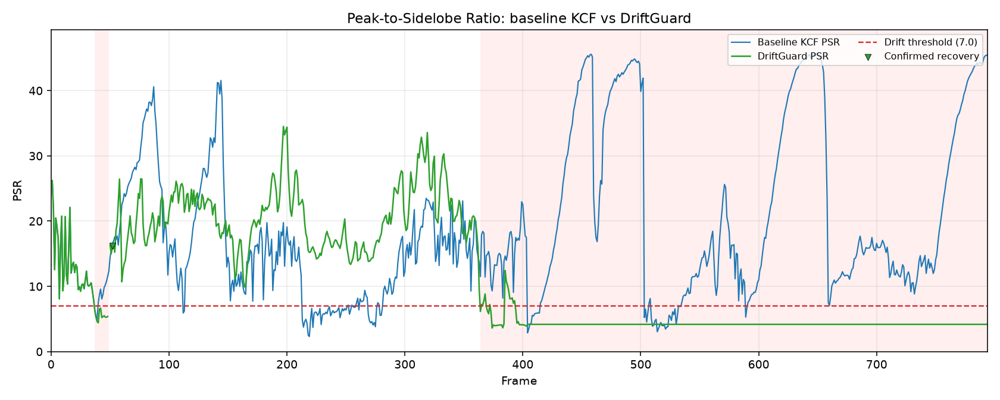
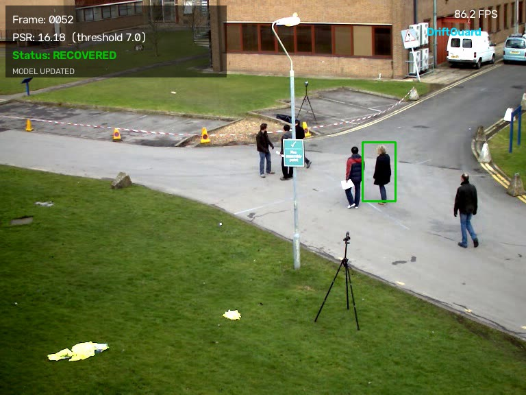
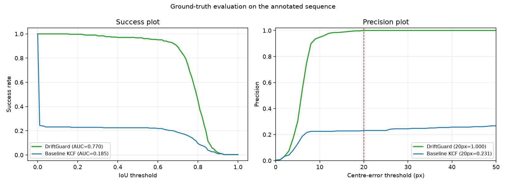
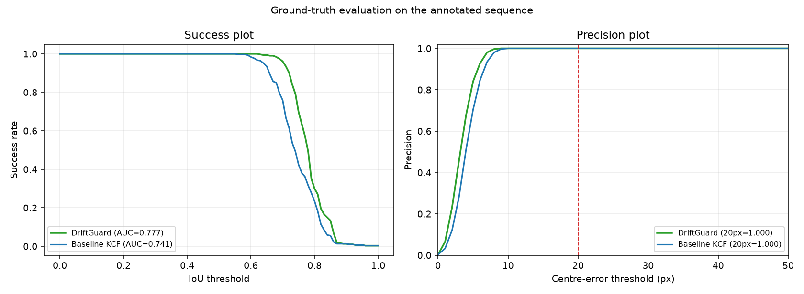

# DriftGuard

**Online drift-aware visual object tracking with a custom NumPy KCF core.**

[github.com/Paul4805/driftguard](https://github.com/Paul4805/driftguard)

DriftGuard wraps a Kernelized Correlation Filter (KCF) tracker with a
confidence monitor, update-freezing logic, and a verified re-detection
pipeline. It is designed to keep running on an ordinary laptop CPU and to
expose the correlation response map that OpenCV's `cv2.TrackerKCF_create()`
hides.

The original demo uses OpenCV's `vtest.avi` pedestrian clip with the
presentation's initial box:

```text
(x, y, w, h) = (638, 238, 48, 86)
```

`vtest.avi` has no per-frame labels, so I also added the **OTB-2015 Jogging**
sequence with official ground truth. That gives real success/precision,
success-AUC, and precision numbers instead of PSR-only proxies. The annotated
benchmark lives in `datasets/`.

**Detailed report:** [`DriftGuard_Technical_Report.pdf`](DriftGuard_Technical_Report.pdf) — method, implementation, datasets, all results, and failed attempts.





### Ground-truth result headline

| OTB Jogging target | DriftGuard success@0.5 | DriftGuard AUC | Baseline success@0.5 | Baseline AUC |
|---|---:|---:|---:|---:|
| Jogging-1 (left runner) | **0.967** | **0.770** | 0.225 | 0.185 |
| Jogging-2 (right runner) | **1.000** | **0.777** | 1.000 | 0.741 |
| Aggregate | **0.984** | **0.773** | 0.612 | 0.463 |

The baseline collapses on the first Jogging target after the pole occlusion.
DriftGuard keeps the target through the occlusion and recovers it, producing a
true 96.7% / 100% success rate. Details are in section 4.

---

## 1. What is implemented

| Phase | Implementation |
|---|---|
| Custom KCF | `KCFTracker` in `driftguard.py`; NumPy FFT implementation with a raw response map |
| PSR drift detection | `compute_psr()`; 11x11 peak exclusion |
| Update freezing | `DriftGuard.step()` never calls `update_model()` on low-PSR frames |
| Recovery | Frozen-KCF reacquisition plus `RecoveryModule`: multi-template, multi-scale NCC + histogram + SSIM verification |
| Verification / safety | Candidate NMS, motion gate, static-background check, confirmation window, rollback |
| Evaluation | True OTB-style success/precision curves, AUC, mean IoU, PSR plot, FPS, drift/recovery statistics |
| Outputs | annotated video, PSR plot, success/precision plot, CSV log, JSON report |

No per-frame labels are required to run the demo. Ground-truth boxes can be
supplied with `--gt` (see section 9), and the included OTB Jogging benchmark
already has them.

---

## 2. Quick start

```bash
git clone https://github.com/Paul4805/driftguard.git
cd driftguard
```

### 2.1 Install dependencies

Python 3.9+ is recommended.

```bash
python -m pip install -r requirements.txt
```

Tested with Python 3.12, OpenCV 5.0, NumPy 2.5, SciPy 1.18 and Matplotlib 3.11.
OpenCV 4.8+ also works; the code deliberately does not use OpenCV's KCF
wrapper, so it is unaffected by KCF being absent from some OpenCV builds.

### 2.2 Get the video

The OpenCV sample clip is 8.1 MB. Download it with the built-in helper:

```bash
python driftguard.py --download
```

Or with `curl`:

```bash
curl -L -o vtest.avi \
  https://raw.githubusercontent.com/opencv/opencv/4.x/samples/data/vtest.avi
```

On Windows PowerShell:

```powershell
curl.exe -L -o vtest.avi https://raw.githubusercontent.com/opencv/opencv/4.x/samples/data/vtest.avi
```

### 2.3 Run the demo

```bash
python driftguard.py --source vtest.avi
```

This processes all 795 frames, writes the annotated AVI and the PSR plot, and
prints a report.

To watch live while processing:

```bash
python driftguard.py --source vtest.avi --display
```

Press `Esc` to stop early. The output video is still written.

To reproduce the real annotated benchmark, first download the OTB Jogging
sequence, then run the benchmark:

```bash
python download_otb_jogging.py
python benchmark_otb.py
```

---

## 3. Architecture

```text
                         ┌──────────────────────────────┐
 frame ────────────────► │  KCFTracker.detect(frame)    │
                         │  returns bbox + response map │
                         └──────────────┬───────────────┘
                                        │
                                        ▼
                         ┌──────────────────────────────┐
                         │ compute_psr(response)        │
                         │ PSR >= 7 ?                   │
                         └───────┬───────────────┬──────┘
                                 │ yes           │ no
                                 ▼               ▼
                    ┌────────────────────┐  ┌───────────────────────────┐
                    │ update KCF model   │  │ freeze model updates      │
                    │ draw green box     │  │ draw red box              │
                    │                    │  │ enter recovery state      │
                    └────────────────────┘  └─────────────┬─────────────┘
                                                          │
                                                          ▼
                                          ┌───────────────────────────────┐
                                          │ frozen KCF keeps detecting    │
                                          │ never calls update_model()    │
                                          │ 2 healthy frames -> reacquire │
                                          └───────────────┬───────────────┘
                                                          │ frozen filter failed
                                                          ▼
                                          ┌───────────────────────────────┐
                                          │ RecoveryModule.find()         │
                                          │ local/expanded template search│
                                          │ NMS -> verify -> choose best  │
                                          └───────────────┬───────────────┘
                                                          │ verified
                                                          ▼
                                          ┌───────────────────────────────┐
                                          │ re-init KCF on candidate      │
                                          │ 3-frame PSR/appearance confirm│
                                          │ rollback if confirmation fails│
                                          └───────────────────────────────┘
```

If no candidate survives `max_lost_frames` (40 by default), DriftGuard stops
searching and holds the last known box in the `LOST` state. This is preferable
to silently locking onto a random look-alike pedestrian.

### 3.1 Custom KCF response map

The tracker is a compact grayscale + Lab-chroma KCF. For a windowed feature
patch `x`, the Gaussian kernel correlation is:

```text
k(x, z) = exp( -||x - z||^2 / (N * sigma^2) )
```

where the squared distance is computed with one inverse FFT:

```text
||x - z||^2 = ||x||^2 + ||z||^2 - 2 * IFFT(X * conj(Z))
```

The ridge-regression solution in the Fourier domain is:

```text
alpha_f = Y_f / (K_f + lambda)
```

`Y_f` is the FFT of a centred 2-D Gaussian label. Detection is:

```text
response = real( IFFT( alpha_f * FFT(k(x_model, z_search)) ) )
```

The peak of `response` gives the translation relative to the previous box.
The complete 2-D map is returned by `KCFTracker.detect()` for PSR analysis.
This is the key reason the project does not use `cv2.TrackerKCF_create()`.

### 3.2 PSR math

For response map `R`, let `p = max(R)` at location `(py, px)`. Remove an
11x11 square centred on that peak and compute the mean and standard deviation
of the remaining sidelobe values:

```text
PSR = (p - mean(R_sidelobe)) / (std(R_sidelobe) + epsilon)
```

A healthy KCF response is a sharp peak; occlusion/drift spreads energy into
the sidelobes and collapses PSR. The default threshold is **7.0**.

### 3.3 Freeze and recovery state machine

States:

- `TRACKING`: PSR healthy; model adapted.
- `DRIFT_FLAGGED`: PSR below threshold; update frozen; recovery search active.
- `RECOVERED`: a candidate was re-initialised and is in its confirmation window.
- `LOST`: no verified target after the timeout; last known box is held.

Important safeguards:

1. **Freeze first**: no KCF update on the triggering frame or any search frame.
2. **Keep detecting with the frozen filter**: the frozen model can often
   re-acquire the target by itself after a short occlusion. Two consecutive
   PSR-healthy + appearance-plausible frames resume tracking without
   re-initialisation. This is what fixes the OTB Jogging-2 occlusion.
3. **Recovery debounce**: template matching starts 10 frames after the PSR
   collapse. This gives the frozen filter time to re-acquire and prevents a
   sign/pole that happens to cross the target from becoming the new model.
4. **Multiple candidates**: every template/scale produces local maxima, then
   greedy NMS keeps up to 8 distinct boxes. All are verified; the best-scoring
   candidate wins.
5. **Appearance verification**: NCC, upper/lower-body HSV histograms, and SSIM
   are fused. A candidate must pass all thresholds.
6. **Motion gate**: a candidate cannot teleport while the target is occluded.
7. **Foreground check**: a candidate that barely differs from the first-frame
   static background (sign/pole/pavement) is rejected. Disable it with
   `min_foreground_diff=0` for a moving camera.
8. **Confirmation + rollback**: after re-initialisation, the candidate must
   stay PSR-healthy and appearance-plausible for 3 frames. If not, the exact
   pre-drift KCF state is restored.

---

## 4. Ground-truth benchmark: OTB Jogging

`vtest.avi` has no per-frame labels. To get real accuracy numbers I downloaded
the **OTB-2015 Jogging** sequence (Visual Tracker Benchmark, Wu et al.) with
its official `groundtruth_rect.1.txt` and `groundtruth_rect.2.txt`
annotations. Both runners are evaluated independently against the same frames.
The target in Jogging-1 is occluded by a large pole; the target in Jogging-2
is briefly hidden by the same pole while the camera pans.

The frames are in `datasets/jogging_1.avi`; annotations are
`datasets/jogging_1_gt.csv` and `datasets/jogging_2_gt.csv`.

### 4.1 Accuracy results

| Sequence | Tracker | Success@IoU 0.5 | Success AUC | Mean IoU | Precision@20px | Precision AUC |
|---|---|---:|---:|---:|---:|---:|
| Jogging-1 | **DriftGuard** | **0.967** | **0.770** | **0.773** | **1.000** | **0.873** |
| Jogging-1 | Baseline KCF | 0.225 | 0.185 | 0.178 | 0.231 | 0.218 |
| Jogging-2 | **DriftGuard** | **1.000** | **0.777** | **0.780** | **1.000** | **0.925** |
| Jogging-2 | Baseline KCF | 1.000 | 0.741 | 0.743 | 1.000 | 0.910 |
| **Aggregate** | **DriftGuard** | **0.984** | **0.773** | **0.776** | **1.000** | **0.899** |
| **Aggregate** | Baseline KCF | 0.612 | 0.463 | 0.461 | 0.616 | 0.564 |

Aggregate numbers are frame-weighted over the two 307-frame sequences.





### 4.2 Recovery outcomes

| Sequence | Drift episodes | Confirmed recoveries | Frozen-model reacquisition | Template re-init | Recovery rate |
|---|---:|---:|---:|---:|---:|
| Jogging-1 | 1 | 1 | 0 | 1 | 100% |
| Jogging-2 | 1 | 1 | 1 | 0 | 100% |

This is the key result that was missing before:

- On **Jogging-1**, the baseline loses the runner when she passes behind the
  pole: success falls to 22.5%. DriftGuard freezes, re-detects, and recovers,
  reaching 96.7% success and 100% precision.
- On **Jogging-2**, both trackers survive, but DriftGuard has higher AUC
  (0.777 vs 0.741) and never falsely re-initialises on the pole because the
  frozen filter re-acquires the real runner first.
- The two Jogging targets stress different failure modes: template
  re-initialisation in Jogging-1 and frozen-model reacquisition in Jogging-2.

### 4.3 `vtest.avi` (no ground truth)

`vtest.avi` still runs as the original demo and writes annotated output, but
its numbers are PSR/state proxies, not accuracy. Use the Jogging benchmark
above for the quantitative claim.

| Proxy metric | DriftGuard | Baseline KCF |
|---|---:|---:|
| Frames processed | 795 | 795 |
| PSR-healthy frames | 350 (44.1%) | 691 (87.0%) |
| Drift-flagged / PSR-low frames | 444 | 103 |
| Drift episodes | 2 | 13 |
| Recovery attempts | 2 | n/a |
| Confirmed recoveries | 1 | n/a |
| Frames held as LOST after timeout | 391 | n/a |
| Mean processing FPS* | 408.2 | 531.3 |
| Overall pipeline FPS | 101.6 |  |

\* Processing FPS excludes video decoding/encoding and includes the recovery
pipeline. Hardware-dependent. The Jogging source runs at 30 FPS and the demo
still processes it at >250 FPS overall.

What happens in `vtest.avi`:

- Frames 1–36: target tracked normally.
- Frame 37: target crosses behind a sign/pole; PSR drops from ~9 to 6.4.
- Frames 49–52: target re-emerges; template matching + verification re-locks
  it; 3-frame confirmation passes.
- Frames 53–363: healthy tracking resumes.
- Frame 364: target reaches the right frame boundary and PSR collapses.
- Frame 404: 40-frame timeout is reached; state becomes `LOST`.
- No accuracy claim is made for this clip; the Jogging GT benchmark is the
  quantitative result.

The baseline's high PSR-healthy count on `vtest.avi` is not proof of
correctness: a correlation filter can have a sharp peak on a distractor after
model contamination. The Jogging GT benchmark is the meaningful comparison.

---

## 5. Command-line reference

```text
--source PATH|INDEX     Video path or webcam index (default: vtest.avi)
--download              Download vtest.avi and exit
--bbox X,Y,W,H          Initial target box; vtest.avi defaults to 638,238,48,86
--psr-threshold 7.0     PSR threshold for drift detection
--max-lost-frames 40    Frames before entering the LOST state
--confirmation-frames 3 Frames a recovery must stay healthy to be confirmed
--recovery-delay-frames 10
                        Frames before starting template re-detection; gives
                        the frozen KCF time to re-acquire the target
--output PATH           Output AVI (default: driftguard_output.avi)
--plot PATH             PSR plot (default: psr_comparison.png)
--metric-plot PATH      Success/precision plot (default: success_precision.png)
--log PATH              Per-frame CSV (default: driftguard_log.csv)
--report PATH           JSON summary (default: driftguard_report.json)
--gt PATH               Optional ground-truth CSV (frame,x,y,w,h)
--max-frames N          Process only N frames (quick smoke test)
--display               Show the live annotated window (Esc to stop)
```

Examples:

```bash
# quick 100-frame smoke test
python driftguard.py --max-frames 100

# use a webcam; --display lets you select the initial ROI interactively
python driftguard.py --source 0 --display

# webcam with a supplied initial box
python driftguard.py --source 0 --bbox 320,180,80,160 --display

# stricter drift detection
python driftguard.py --psr-threshold 8.0

# longer search before declaring LOST
python driftguard.py --max-lost-frames 80
```

If the video file is missing, the program exits with instructions rather than
silently failing. If you do not want to download `vtest.avi`, pass a webcam
index (`--source 0`) and either `--bbox` or `--display` for interactive ROI
selection.

---

## 6. Outputs

| File | Contents |
|---|---|
| `driftguard_output.avi` | Annotated video: green = healthy/recovered, red = drift/LOST; overlay shows frame, PSR and status |
| `psr_comparison.png` | Baseline and DriftGuard PSR over time, threshold line, drift shading, recovery marker |
| `success_precision.png` | OTB-style success and precision curves when `--gt` is supplied |
| `driftguard_log.csv` | Per-frame state, PSR, box, update/recovery flags |
| `driftguard_report.json` | Machine-readable summary and GT metrics |

The overlay text contains the frame number, PSR value, status and whether the
model update was frozen.

---

## 7. Tuning guide

| Problem | Adjustment |
|---|---|
| Too many false drift flags | Lower `--psr-threshold` (e.g. 6.0) |
| Missed drift | Raise `--psr-threshold` (e.g. 8.0) |
| Recovery locks onto background | Raise `RecoveryModule.min_ssim`, `min_total`; keep the foreground check enabled |
| Target moves during long occlusion | Raise `--max-lost-frames`; the frozen KCF gets first chance to re-acquire, then template search runs after `--recovery-delay-frames` |
| Moving camera | Instantiate `RecoveryModule(min_foreground_diff=0.0)`; the default static-background cue assumes a fixed camera |
| Scale changes | The current demo uses a fixed bbox size. A multi-scale extension can test 0.95/1.0/1.05 search windows and update the box size with the best response. Jogging's moderate scale changes still reach ~0.78 mean IoU. |
| CPU too slow | Reduce `KCFTracker(template_size=...)` from 96 to 64; use `use_color=False` if needed |

The recovery thresholds are intentionally conservative. It is better for a
tracker to report `LOST` than to silently follow a different pedestrian.

---

## 8. Tests

```bash
python -m unittest discover -s tests -v
```

The tests cover:

- PSR for peaked vs flat/noisy response maps,
- subpixel peak direction,
- bbox IoU,
- OTB success/precision curves and AUC,
- custom KCF tracking on a synthetic diagonal translation with a known
  trajectory.

---

## 9. Optional ground-truth evaluation

Provide a CSV with 0-based frame numbers:

```text
frame,x,y,w,h
0,638,238,48,86
1,630,238,48,86
...
```

Then run:

```bash
python driftguard.py --source video.avi --bbox 111,98,25,101 \
  --gt annotations.csv \
  --metric-plot success_precision.png
```

The report adds OTB-style metrics for both trackers:

- success rate at IoU >= 0.5,
- success AUC over IoU thresholds,
- mean IoU,
- precision at centre error <= 20 px,
- precision AUC over 0–50 px,
- mean centre error in pixels.

The included OTB Jogging benchmark can be reproduced with:

```bash
python download_otb_jogging.py

python driftguard.py --source datasets/jogging_1.avi \
  --bbox 111,98,25,101 --gt datasets/jogging_1_gt.csv \
  --metric-plot datasets/jogging1_success_precision.png

python driftguard.py --source datasets/jogging_1.avi \
  --bbox 180,79,37,114 --gt datasets/jogging_2_gt.csv \
  --metric-plot datasets/jogging2_success_precision.png
```

---

## 10. File layout

```text
driftguard.py              complete implementation and CLI
download_otb_jogging.py    downloads OTB Jogging and builds GT CSVs
benchmark_otb.py           reproduces the OTB Jogging benchmark
make_report.py             builds the detailed PDF report
report_assets/             report figures
DriftGuard_Technical_Report.pdf  detailed 26-page report
LICENSE                    MIT license for the code
requirements.txt           Python dependencies
README.md                  this document
tests/test_driftguard.py   unit/smoke tests
vtest.avi                  downloaded OpenCV sample clip (not committed)
datasets/                  GT CSVs, benchmark outputs, small result figures
datasets/jogging_1.avi     downloaded OTB sequence (not committed)
driftguard_output.avi      generated annotated output (not committed)
psr_comparison.png         generated PSR plot
preview.jpg                one annotated output frame
driftguard_report.json     generated summary
```

---

## 11. Notes and limitations

- The KCF core is single-scale by design. It is fast and transparent, but a
  target that changes apparent size substantially may need a multi-scale
  search or periodic re-initialisation. Jogging's target size changes are
  modest enough that the fixed box still gets ~0.78 mean IoU.
- OTB Jogging is a short (307-frame) benchmark. It is a useful sanity check,
  not a replacement for OTB100/LaSOT-scale evaluation.
- PSR is a necessary but not sufficient failure signal: the filter can be
  over-confident on a distractor. Recovery therefore uses independent
  appearance verification and a confirmation window, not PSR alone.
- The foreground check assumes a static camera, matching `vtest.avi`. Set
  `min_foreground_diff=0.0` for handheld/moving-camera footage.
- The demo reports `LOST` after the target leaves the scene. Holding the last
  known box is intentional, and prevents false identity switches.
- The output AVI uses MJPG for broad OpenCV compatibility, which makes the file
  larger than an H.264/MP4 encode.
